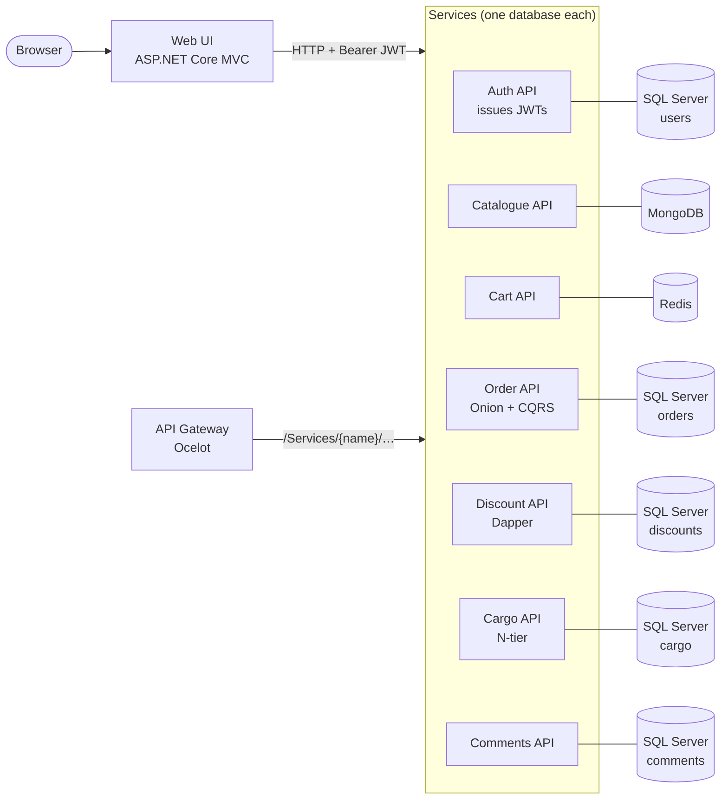
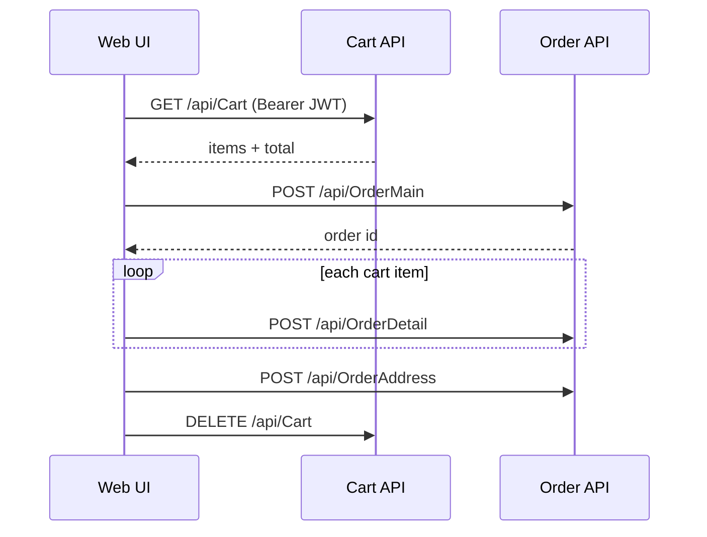

# Trade Site — E-commerce Microservices on .NET 10

> **Status: work in progress.** Messaging, containerised deployment and CI are on the [roadmap](#roadmap).

An e-commerce system split into seven ASP.NET Core Web API services — auth, catalogue, cart, orders, discounts, shipping and product reviews — behind an Ocelot API gateway, with an MVC storefront and admin panel on top. Each service owns its own database and can be run, changed and migrated on its own.

The services use different internal structures and data-access styles (Onion + CQRS, classic N-tier, Dapper, MongoDB, Redis), which makes the trade-offs easy to compare side by side in one codebase.

## Architecture



| Service | What it does | Internal structure | Data store / access | Auth | Local URL |
|---|---|---|---|---|---|
| **Gateway** | Single entry point: `/Services/{name}/{path}` → `/api/{path}` on each service | Ocelot | — | Validates JWT for cart, order and cargo routes | `http://localhost:5000` |
| **Auth** | Register, log in, `GET /me`; issues signed JWTs | Service layer | SQL Server via EF Core (unique username and email) | Issues tokens | `https://localhost:7060` |
| **Catalogue** | Categories, products, product details and photos | Service layer + AutoMapper | MongoDB (4 collections), MongoDB.Driver | — | `https://localhost:7200` |
| **Cart** | One cart per user | Service layer | Redis (StackExchange.Redis), one JSON value per user | JWT required | `https://localhost:7130` |
| **Order** (`Demand`) | Orders, order lines, delivery addresses | Onion: Domain / Application / Infrastructure / Presentation, CQRS | SQL Server via EF Core | JWT required for writes | `https://localhost:7016` |
| **Discount** (`Price_Drop`) | Discount codes with rate, status and end date | Service layer | SQL Server via Dapper with parameterised SQL (EF Core only for migrations) | — | `https://localhost:7039` |
| **Cargo** | Shipments, carriers, customer records, tracking status | N-tier: Entity / DataAccess / Business / DTO / WebAPI | SQL Server via EF Core + generic repository | JWT required | `https://localhost:7054` |
| **Comments** | Product reviews with rating | Service layer + AutoMapper | SQL Server via EF Core | — | `https://localhost:7276` |
| **Web UI** | Storefront (sign-in, cart, checkout, order history, reviews) and admin panel | ASP.NET Core MVC, view components, cookie auth | Calls the services over HTTP | Cookie holding the user's JWT | `https://localhost:7048` |

Every API exposes Swagger at `/swagger` in the Development environment.

### Checkout across services

The MVC app signs the user in with a cookie that carries the JWT from the Auth service, and forwards that token on every call:



## Design notes

- **Database per service.** No service reads another service's tables; the admin panel manages products, reviews and orders through the services' APIs rather than their databases.
- **One entry point, checked twice.** The gateway rejects requests to the cart, order and cargo routes that carry no valid token, and those services validate the token again themselves, so they stay protected when called directly.
- **Stateless tokens.** The Auth service signs HS256 tokens carrying `sub`, username, email and role claims (60-minute lifetime). Other services validate issuer, audience, lifetime and signature locally with the shared key — no call back to Auth on each request.
- **Identity comes from the token, not the request.** The Cart API overwrites any `UserId` in the request body with the token's `sub` claim, so a user can only read or change their own cart.
- **Onion layering in the Order service.** The Domain project has no dependencies. The Application layer defines the repository interface (`IGenericInterface<T>`) and the command/query handlers; Infrastructure implements it with EF Core; Presentation only wires things up. Order headers are dispatched through MediatR, while order lines and addresses use directly injected handlers — the two CQRS styles sit next to each other for comparison.
- **Hand-written SQL where it is simpler.** The Discount service runs parameterised SQL through Dapper; EF Core is used only to create the schema.
- **No secrets in the repository.** Connection strings with passwords and the JWT key are read from configuration (user-secrets or environment variables). Auth, Cart, Cargo, Order and the gateway refuse to start if a required value is missing or the key is too short.

## Running locally

### Prerequisites

- .NET 10 SDK and the EF Core CLI: `dotnet tool install --global dotnet-ef`
- SQL Server Express (Auth, Comments and Discount use `.\SQLEXPRESS` with Windows authentication by default)
- Docker (for the Order and Cargo SQL Servers, MongoDB and Redis)
- A trusted development certificate: `dotnet dev-certs https --trust`

### 1. Start the containers

```bash
# Orders on 1440, cargo on 1441
docker run -d --name tradesite-sql-order -e ACCEPT_EULA=Y -e MSSQL_SA_PASSWORD='<strong-password>' -p 1440:1433 mcr.microsoft.com/mssql/server:2022-latest
docker run -d --name tradesite-sql-cargo -e ACCEPT_EULA=Y -e MSSQL_SA_PASSWORD='<strong-password>' -p 1441:1433 mcr.microsoft.com/mssql/server:2022-latest

docker run -d --name tradesite-mongo -p 27017:27017 mongo:7
docker run -d --name tradesite-redis -p 6379:6379 redis:7
```

### 2. Configure secrets (once)

All projects share one user-secrets store (`UserSecretsId` = `trade-site-dev`), so each value is set once. Run these from any project folder:

```bash
cd Services/Auth/Trade_Site_Auth_WebAPI

# Shared JWT signing key: at least 32 characters, e.g. from `openssl rand -base64 48`
dotnet user-secrets set "Jwt:Key" "<random-key>"

dotnet user-secrets set "ConnectionStrings:DemandDb" "Server=localhost,1440;Database=TradeSite_Project;User Id=sa;Password=<strong-password>;TrustServerCertificate=True;"
dotnet user-secrets set "ConnectionStrings:CargoDb"  "Server=localhost,1441;Database=TradeSite_Project_CargoDB;User Id=sa;Password=<strong-password>;TrustServerCertificate=True;"

# Optional: a development-only admin login for the MVC admin panel
dotnet user-secrets set "DevAdmin:Username" "<admin-name>"
dotnet user-secrets set "DevAdmin:Password" "<admin-password>"
```

Environment variables work too (`Jwt__Key`, `ConnectionStrings__DemandDb`, …). Without SQL Server Express, override `ConnectionStrings__DefaultConnection` per service with an environment variable — not in user-secrets, which every service shares, or Auth, Comments and Discount would end up in one database.

### 3. Create the SQL databases

```bash
dotnet ef database update --project Services/Auth/Trade_Site_Auth_WebAPI
dotnet ef database update --project Services/Trade_Site_Comments
dotnet ef database update --project Services/Price_Drop/Trade_Site_Price_Drop
dotnet ef database update --project Services/Demand/Infrastructure/Trade_Site_Infrastructure_Persistence \
                          --startup-project Services/Demand/Presentation/Trade_Site_Demand_Presentation
dotnet ef database update --project Services/Cargo/Trade_Site_Cargo_DataAccessLayer \
                          --startup-project Services/Cargo/Trade_Site_Cargo_WebAPI
```

MongoDB and Redis need no setup; collections and keys are created on first write.

### 4. Run

Open `Trade_Site.slnx` in Visual Studio or Rider and start the services, the gateway and `UI/Trade_Site_WebUI` together (multiple startup projects, `https` profile), or run each from a terminal:

```bash
dotnet run --project Services/Auth/Trade_Site_Auth_WebAPI --launch-profile https
dotnet run --project OcelotGateway/Trade_Site_OcelotGateway --launch-profile http
# ...and so on for the other projects
```

### 5. Try the auth flow from the command line

```bash
curl -sk https://localhost:7060/api/Auth/register \
  -H "Content-Type: application/json" \
  -d '{"username":"demo","email":"demo@example.com","password":"Passw0rd!"}'

TOKEN=$(curl -sk https://localhost:7060/api/Auth/login \
  -H "Content-Type: application/json" \
  -d '{"usernameOrEmail":"demo","password":"Passw0rd!"}' | jq -r .token)

# Save and read the cart; the user comes from the token
curl -sk https://localhost:7130/api/Cart -H "Authorization: Bearer $TOKEN" \
  -H "Content-Type: application/json" \
  -d '{"cartItems":[{"productId":"p1","productName":"T-shirt","quantity":2,"price":250}]}'

curl -sk https://localhost:7130/api/Cart -H "Authorization: Bearer $TOKEN"
# → {"userId":"…","cartItems":[…],"totalPrice":500, …}
```

Through the gateway the same calls are `http://localhost:5000/Services/Auth/Auth/login` and `http://localhost:5000/Services/Cart/Cart`.

## Repository layout

```
OcelotGateway/   Trade_Site_OcelotGateway   (routes in ocelot.json)
Services/
  Auth/          Trade_Site_Auth_WebAPI
  Catalogue/     Trade_Site_Catalogue
  Cart/          Trade_Site_Cart_WebAPI
  Demand/        Core/{Domain, Application}  Infrastructure/Persistence  Presentation
  Price_Drop/    Trade_Site_Price_Drop
  Cargo/         EntityLayer  DataAccessLayer  BusinessLayer  DtoLayer  WebAPI
  Trade_Site_Comments/
UI/
  Trade_Site_WebUI           MVC storefront + AdminArea
  Trade_Site_WebUI_Dto_Layer
```

## Known limitations

- The UI still calls most services directly by hard-coded URL; only the review form goes through the gateway.
- Checkout is a sequence of separate calls made by the UI with no rollback: if a later step fails, the records created before it remain.
- Order reads are anonymous (so the admin panel can list orders), which means anyone who knows a user ID can read that user's orders. Only writes require a token.
- The admin area has no authorization yet; the development admin login is a convenience, not access control.
- Passwords are salted SHA-256 hashes; PBKDF2 is planned.
- Catalogue, Discount and Comments endpoints are open, and the cart stores a discount code without applying it to the total.
- No automated tests yet.

## Roadmap

- [ ] Route all UI traffic through the gateway
- [ ] RabbitMQ events between services (e.g. order placed → cart cleared), replacing the UI-driven checkout sequence
- [ ] `docker-compose` for the full stack
- [ ] GitHub Actions: build and test on every push
- [ ] Role-based authorization for the admin area and order reads; PBKDF2 password hashing
- [ ] Unit and integration tests
